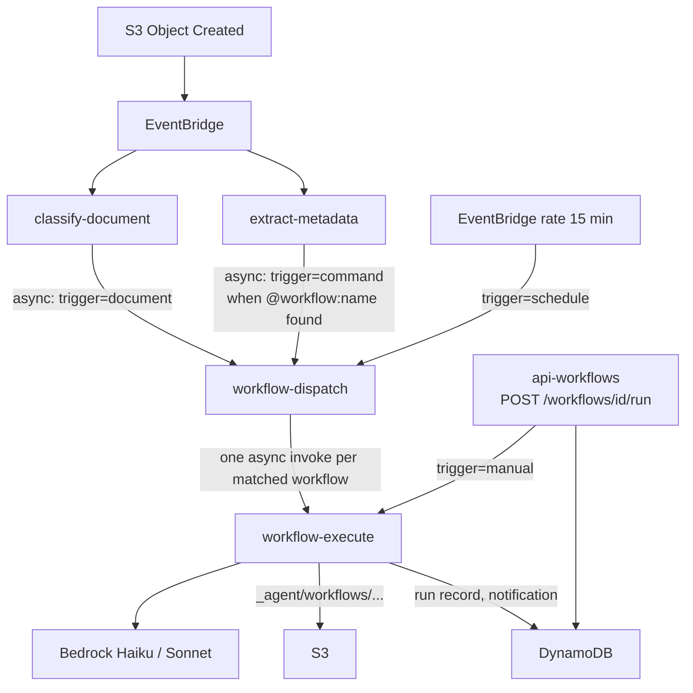

# Task 0026: Custom Agent Workflows

**Status**: In Progress

## Specifications

Allow users to define custom AI agent workflows — configurable automation rules that trigger on specific events and execute AI-powered processing with user-defined prompts. This generalizes the pattern established by existing Lambdas (classify, summarize, extract) into a user-configurable framework where users can create their own processing rules.

### Workflow Definition

Each workflow specifies:
- **Trigger**: What event starts the workflow (new document, classification match, schedule, manual, @command)
- **Filter**: Optional conditions (document path prefix, tags, classification type)
- **Prompt template**: User-defined prompt with variable interpolation (`{{document.content}}`, `{{document.tags}}`, `{{entity.names}}`)
- **Model**: Which Bedrock model to use (Haiku for fast, Sonnet for complex)
- **Output destination**: Where to write results (`_agent/workflows/{workflow-id}/`, DynamoDB, or notification)

### Example Workflows

- "When a document is classified as 'meeting', extract action items and write to `_agent/actions/`"
- "Every Monday, summarize all documents tagged #project-x from the past week"
- "When @workflow:research is detected, perform deep analysis using Sonnet and write report"

**Depends on:** Task 0023 (Command Interface) for @command-triggered workflows.

## Design (Step 1)

### Architecture



Three new Lambdas. `workflow-dispatch` is cheap and fast: it loads enabled workflow definitions, matches the incoming event against each trigger and filter, and fires one async `workflow-execute` invocation per match. `workflow-execute` is the heavy step: it builds the interpolation context, renders the prompt, calls Bedrock, writes the output and records the run. `api-workflows` serves all CRUD, manual-run and run-history routes from one handler, following `api_agent_types` and `api_search_monitors`.

### DynamoDB Key Structure

All items live in the existing `pkm-metadata` single table. Attribute names are `snake_case` in DynamoDB and `camelCase` in the API, matching the rest of the codebase.

| Item | PK | SK | Purpose |
|---|---|---|---|
| Workflow definition | `workflow#def` | `wf#<workflow-id>` | One partition holds every workflow; listing is a single query. Definitions are vault-wide, not per user, because triggers fire on vault-wide events. |
| Run record | `workflow#run#<workflow-id>` | `run#<started-iso>#<run-id>` | Newest-first run history per workflow via `begins_with(SK, "run#")` and `scan-index-forward false`. |
| Cooldown marker | `workflow#run#<workflow-id>` | `doc#<document-path>` | Last run time per (workflow, document) so repeated saves of one note do not re-run a document workflow inside its cooldown window. |

No new GSI is needed. Workflow counts are small (tens, not thousands), so the scheduler polls the `workflow#def` partition and filters in memory, the same way `persistent_search_execute` could have but without the dedicated index.

**Workflow definition attributes**

```
workflow_id        uuid
name               slug, unique across workflows (^[a-z0-9][a-z0-9-]{1,63}$); used in @workflow:<name> and output paths
description        free text
enabled            bool
trigger            {type: "document" | "schedule" | "manual" | "command",
                    schedule: {frequency: "hourly" | "daily" | "weekly", minute, hour, day_of_week}}
filter             {path_prefix, tags [..], classifications [..], lookback_days}
prompt             {system, user, model: "haiku" | "sonnet", max_tokens, temperature}
output             {destination: "s3" | "dynamodb" | "notification", path}
cooldown_minutes   default 60; applies to document and command triggers
next_run           ISO timestamp, schedule trigger only
last_run, last_status, run_count
created, updated, created_by (Cognito sub)
```

**Run record attributes**

```
run_id, workflow_id, workflow_name, trigger, status ("running" | "completed" | "failed")
document_path (document/command/manual triggers), document_count (schedule)
started, completed, duration_ms
model_id, input_tokens, output_tokens      (from the Bedrock response usage block)
output_s3_key                              (s3 destination)
result                                     (truncated to 32 KB; the full text is in S3 for the s3 destination)
error
```

### Triggers

| Type | Fired by | Context | Notes |
|---|---|---|---|
| `document` | `classify_document`, after it stores (or, for an override, confirms) the classification, via async invoke of `workflow-dispatch` with `{trigger: "document", documentPath, bucket}` | The one document | Firing after classification is what makes `filter.classifications` reliable. Fires on every S3 Object Created for a matching path, so edits re-trigger; `cooldown_minutes` bounds that. `extract_entities` runs in parallel, so `entity.*` may be empty if entity extraction has not finished when the run starts; `workflow-execute` reloads METADATA at run time, which closes the window in practice. |
| `schedule` | One EventBridge rule, `rate(15 minutes)`, invokes `workflow-dispatch` with `{trigger: "schedule"}` | The document set selected by `filter` within `filter.lookback_days` (default 7) | Dispatch claims a due workflow with a conditional update (`next_run = :expected`) before invoking execute, so overlapping polls cannot double-fire. Schedules are UTC in v1 and have 15-minute granularity. `frequency: hourly` uses `minute`; `daily` uses `hour` and `minute`; `weekly` adds `day_of_week` (`monday`..`sunday`). |
| `manual` | `POST /workflows/{id}/run` with optional `{documentPath}` | The named document if given, else the filter-selected document set as for `schedule` | Returns 202 with the run id. Allowed for any trigger type, not only `manual`, so users can test a document workflow against a chosen note. |
| `command` | `extract_metadata`, when `command.parser/parse-workflow-commands` finds `@workflow:<name> [args]` on its own line outside fenced code blocks, via async invoke of `workflow-dispatch` with `{trigger: "command", documentPath, bucket, commands: [{name, args, lineNumber}]}` | The containing document plus `command.args` | Matched by `name` slug. An unknown name is logged and recorded nowhere; a disabled workflow is skipped. Trigger type must be `command` for a workflow to be addressable this way. |

**Filter semantics (all conditions must hold; an absent condition matches everything).**
- `path_prefix`: `document.path` starts with the prefix (case-sensitive, matches S3 keys exactly).
- `tags`: the document has at least one of the listed tags (case-insensitive, `#` stripped).
- `classifications`: the document classification is one of the listed values.
- `lookback_days`: schedule and manual set selection only; documents whose `modified` is within the window, via `ddb/get-documents-modified-since`, then narrowed by the other conditions. The set is capped at 50 documents, newest first.

### Prompt Templates

`workflow.engine/render` performs `{{path.to.value}}` substitution with dotted lookup into a context map. An unresolvable path renders as an empty string and is logged. Lists render comma-separated, maps render as JSON, nil renders empty. There are no filters or conditionals in v1; both `prompt.system` and `prompt.user` and `output.path` are templates.

| Variable | Value |
|---|---|
| `document.path`, `document.title` | S3 key and title from METADATA (title falls back to the filename) |
| `document.content` | Full markdown as stored, truncated to 60,000 characters |
| `document.body` | Content with YAML frontmatter stripped, same truncation |
| `document.tags`, `document.classification`, `document.created`, `document.modified` | From METADATA |
| `document.frontmatter.<key>` | Any frontmatter field |
| `entity.people`, `entity.organizations`, `entity.concepts`, `entity.locations`, `entity.names` | From the METADATA `entities` map; `names` is the union |
| `documents.count`, `documents.list`, `documents.content` | Schedule and manual set context; `list` is one `- title (path)` line per document, `content` is each body under a `## title` heading, with the whole block truncated to 120,000 characters |
| `command.args`, `command.text` | Text after `@workflow:<name>` and the full command line |
| `workflow.id`, `workflow.name`, `run.id` | Identity of the current run |
| `now.iso`, `now.date`, `now.weekday` | UTC run time |

### Model Selection

`prompt.model` is the logical name `haiku` or `sonnet`. `workflow-execute` maps it through `BEDROCK_HAIKU_MODEL_ID` and `BEDROCK_SONNET_MODEL_ID` (both already defined in `terraform/variables.tf`), so model upgrades stay a Terraform change. `max_tokens` defaults to 4096 (cap 16000); `temperature` defaults to 0.7.

### Output

Every run writes a run record. `output.destination` adds:

- `s3`: writes a markdown file with a frontmatter header (`workflow`, `run_id`, `trigger`, `source_document`, `model`, `generated_at`) followed by the model output. `output.path` is a template; the default is `_agent/workflows/{{workflow.name}}/{{now.date}}-{{run.id}}.md`. The rendered path is normalized (no `..`, no leading `/`, `.md` appended if missing, unsafe characters replaced) and **must resolve under `_agent/`**. This is a safety boundary, not a convention: `_agent/` is excluded from the processing EventBridge rules and from `extract_metadata`, so workflow output can never overwrite a user note, re-enter the pipeline, or fire another workflow, and `@workflow:` lines inside output are never parsed. A path that escapes `_agent/` fails the run.
- `dynamodb`: run record only, with the result stored on it.
- `notification`: run record plus a `notification#pending#<ts>#<id>` item under `user#<created_by>` with `notification_type "workflow"`, title `Workflow: <name>`, body from the first 500 characters of the result and deep link `/workflows/<workflow-id>/runs/<run-id>`. The existing `notification_dispatch` stream consumer delivers it unchanged.

### API

All routes are JWT-protected. Reads are open to signed-in users; create, update, delete and run require the `admin` group (same rule as webhook sources and agent types, since workflows spend Bedrock tokens and write to the vault).

| Route | Purpose |
|---|---|
| `GET /workflows` | List definitions |
| `POST /workflows` | Create; validates name uniqueness and slug shape, trigger and schedule, model, destination, output path prefix, template syntax |
| `GET /workflows/{id}` | Definition plus the five most recent runs |
| `PUT /workflows/{id}` | Partial update with the same validation; recomputes `next_run` when the schedule or `enabled` changes |
| `DELETE /workflows/{id}` | Deletes the definition and its run and cooldown items |
| `POST /workflows/{id}/run` | Manual run, 202 with `runId` |
| `GET /workflows/{id}/runs` | Run history, newest first, cursor-paginated like `GET /dispatch/jobs` |

### Terraform

`terraform/workflows.tf`, gated by a new `enable_workflows` variable (default `true`, same `for_each` idiom as `enable_dispatch`):

- Lambdas: `workflow-dispatch` (256 MB, 30 s), `workflow-execute` (1024 MB, 300 s, env includes both Bedrock model ids), `api-workflows` (256 MB, 30 s), each with a log group and the shared DLQ.
- EventBridge rule `pkm-agent-workflow-schedule`, `rate(15 minutes)`, constant input `{"trigger":"schedule"}`, targeting `workflow-dispatch`.
- `WORKFLOW_DISPATCH_FUNCTION_NAME` added to the `classify_document` and `extract_metadata` environments (empty string when disabled; both handlers skip when unset, as `extract_metadata` already does for `COMMAND_PROCESS_FUNCTION_NAME`).
- `WORKFLOW_EXECUTE_FUNCTION_NAME` on `workflow-dispatch` and `api-workflows`.
- Seven API Gateway routes and the matching Lambda permissions.
- The shared `lambda_execution` role already covers Bedrock, S3, DynamoDB and Lambda invoke; confirm in Step 7 and add only what is missing.

### iOS

Workflows are reached from the Insights tab alongside Dispatch. `WorkflowListView` shows name, trigger type, enabled state and last run status with a toggle; `WorkflowFormView` edits trigger, schedule, filter, prompt (system and user templates with a variable reference sheet), model and output; `WorkflowRunsView` shows run history and the result text. Models and view models follow `DispatchJob` and `SearchMonitor`.

## Relevant Files

### New Lambda Functions
- `lambda/functions/workflow_dispatch/handler.clj` — Match events (document, schedule, command) against workflow definitions and invoke execution
- `lambda/functions/workflow_execute/handler.clj` — Build context, render prompt, invoke Bedrock, write output and run record
- `lambda/functions/api_workflows/handler.clj` — CRUD, manual run and run history API

### New Shared Libraries
- `lambda/shared/workflow/engine.clj` — Template interpolation, context building, output path normalization
- `lambda/shared/workflow/triggers.clj` — Trigger and filter matching, schedule `next_run` computation, cooldown checks
- `lambda/shared/workflow/schema.clj` — Definition validation and API formatting shared by the API and the dispatcher

### Modified
- `lambda/shared/command/parser.clj` — Add `parse-workflow-commands` for `@workflow:<name> [args]`
- `lambda/functions/classify_document/handler.clj` — Invoke `workflow-dispatch` after classification
- `lambda/functions/extract_metadata/handler.clj` — Invoke `workflow-dispatch` for `@workflow:` commands
- `lambda/bb.edn`, `lambda/build.clj`, `lambda/tests/test_runner.clj` — Register functions and tests
- `terraform/lambda.tf` — `WORKFLOW_DISPATCH_FUNCTION_NAME` on classify and extract-metadata
- `terraform/variables.tf` — `enable_workflows`
- `docs/architecture.md` — Function tables and diagram

### Terraform
- `terraform/workflows.tf` — Lambda functions, API routes, schedule rule, permissions

### iOS (new)
- `ios/PKMReader/Features/Workflows/WorkflowListView.swift` — Workflow management UI
- `ios/PKMReader/Features/Workflows/WorkflowFormView.swift` — Create/edit workflow
- `ios/PKMReader/Features/Workflows/WorkflowRunsView.swift` — Run history and results
- `ios/PKMReader/Features/Workflows/WorkflowListViewModel.swift` — List and mutation view model
- `ios/PKMReader/Models/Workflow.swift` — Workflow and WorkflowRun models

### Tests
- `lambda/tests/workflows/engine_test.clj` — Interpolation, context rendering, output path normalization
- `lambda/tests/workflows/triggers_test.clj` — Filter matching, schedule computation, cooldown
- `lambda/tests/workflows/api_test.clj` — Validation and response formatting
- `lambda/tests/command/parser_test.clj` — `@workflow:` parsing

## Acceptance Criteria

- [ ] Workflows can be created, listed, updated, and deleted via API
- [ ] Workflows trigger on configured events (document creation, schedule, manual, @command)
- [ ] Prompt templates support variable interpolation with document and entity data
- [ ] Workflow output written to configured destination
- [ ] Workflow output can never be written outside `_agent/`
- [ ] iOS UI for managing workflows with form for trigger, filter, prompt, and output
- [ ] Unit tests cover template interpolation, trigger matching, and API handlers
- [ ] All existing tests continue to pass

## Implementation Steps

- [x] Step 1: Design workflow definition schema and DynamoDB key structure
- [x] Step 2: Create template interpolation engine (`workflow/engine.clj`) with tests
- [ ] Step 3: Create trigger matching logic (`workflow/triggers.clj`) and `@workflow:` parsing with tests
- [ ] Step 4: Create workflow execution Lambda (`workflow_execute`)
- [ ] Step 5: Create workflow CRUD API Lambda (`api_workflows`) with tests
- [ ] Step 6: Create `workflow_dispatch` Lambda and wire `classify_document` and `extract_metadata` to it
- [ ] Step 7: Add Terraform infrastructure (`workflows.tf`, schedule rule, env vars, routes) and update `docs/architecture.md`
- [ ] Step 8: Create iOS workflow management views
- [ ] Step 9: End-to-end verification against the deployed stack and final test pass
